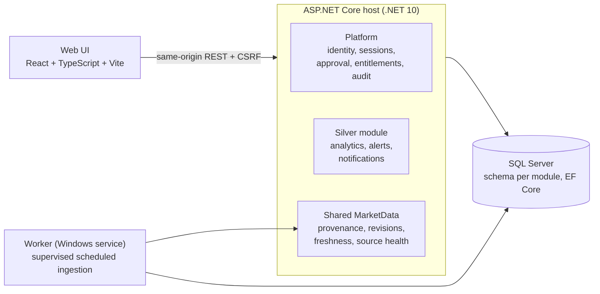

# Market Intelligence Platform

A modular web platform for **collecting, explaining and alerting on investment data** across separate analysis modules (commodities, equities, currencies, industries…). The first reference module is **Silver**.

> This is a public showcase. The source code is in a private repository; this page describes the product, the architecture and how it is being built. Status: **in active development**.

## What it does

- **Module-first product.** Each analysis module (e.g. Silver) is a complete product with its own pages, data model, analytics and alert catalogue. Access is granted per module.
- **Silver module:** price and returns, futures and the futures curve, CFTC positioning, an analytical workspace, and **alerts with in-app notifications**.
- **Shared market data** with full provenance: every value keeps its source, observation time, revisions and freshness, and freshness is shown in the UI.
- **Facts vs. expectations.** Observed facts, market-implied expectations and external forecasts are modelled as different kinds of information. V1 is data + alerts, not predictions or advice.
- **Methodology/transparency section** in every module.

## Architecture

Key design decisions:

- **Modular monolith, not microservices.** Each module owns its own persistence (separate schema and migration history). Shared market data is centralised only when it is genuinely reusable, through explicit contracts.
- **Entitlements are separate from payments.** Module access is an audited, time-bounded grant (purchase, bundle, admin grant…). Administrator status never implies module access, and there is no hidden bypass.
- **Security by default:** `__Host-` HttpOnly/Secure/SameSite cookies, antiforgery on every unsafe route, session limits with explicit capacity selection, sanitised Problem Details with trace IDs (no raw exceptions), DPAPI-protected key persistence, generic login/registration responses.
- **Operator-only migrations.** No `EnsureCreated` or migrations at startup; reviewed idempotent SQL scripts are applied by an operator.
- **Supervised background ingestion.** The Worker never ingests on normal startup; scheduled ingestion is enabled explicitly and runs as a separately installed Windows service.

## Tech stack

| Area | Technology |
| --- | --- |
| Back end | C#, .NET 10, ASP.NET Core, ASP.NET Core Identity, EF Core |
| Database | SQL Server (schema and migration history per module) |
| Front end | React, TypeScript, Vite, Vitest |
| Background work | .NET Worker hosted as a Windows service |
| Hosting | IIS (HTTPS) |
| Quality | Nullable reference types, warnings as errors, architecture tests, HTTP/CSRF tests, published-host smoke tests, opt-in real-SQL integration tests |

## How it is built: a multi-agent workflow

The project is built with AI coding agents (OpenCode), with me as architect and final reviewer:

- An **orchestrator** routes work to role-based agents: *explorer* (repository reconnaissance), *architect* (boundaries, contracts, security design), *implementer*, *reviewer*, and a *critical reviewer* for security-sensitive or high-blast-radius changes (auth, entitlements, migrations).
- Every checkpoint ends with a numbered written report (objective, decisions, changed files, verification, risks, hand-off) and an index entry, so the project history is fully traceable.
- Written rules keep agents safe: no pushes or destructive Git operations, no access to secrets or credential stores, no weakening of authentication, entitlement, auditability or data integrity for convenience.

## Author

**Mohammad Mesbah** – Senior .NET & SQL Server engineer, AI Solutions Engineer. Dubai, open to remote roles.
[LinkedIn](https://www.linkedin.com/in/mohammadhassan-mesbah) · [GitHub](https://github.com/mohammad-mesbah)
